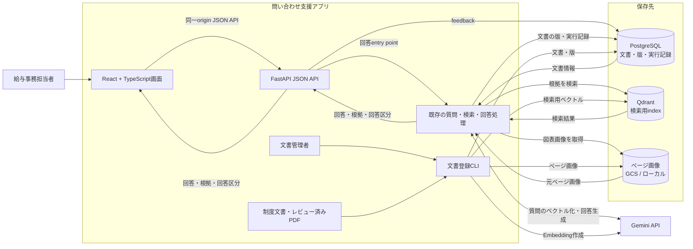
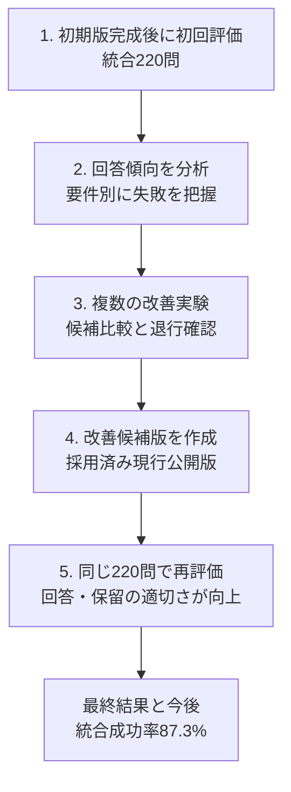

# 自治体の給与事務を支援する、根拠付き問い合わせアプリ

[公開デモ](https://municipal-rag-assistant-280649014820.asia-northeast1.run.app/) · [機能ごとの説明](portfolio/README.md) · [精度改善の詳しい記録](eval/reports/ACCURACY_IMPROVEMENT.md)

## どんな人が、何に使うアプリか

各所属の給与事務担当者や、人事・給与制度を所管する職員が、職員からの制度・手続きの問い合わせに答えるときに使う**調べもの支援アプリ**です。

規程、通知、FAQ、業務マニュアル、申請書の記入例を横断して探し、回答と根拠の場所を一緒に確認できます。たとえば、「給与口座を変更したいときの提出期限は？」「申請書を受け取った後、最初に何を確認する？」といった質問に使います。回答に必要な情報が見つからないときや、個別事情の判断が残るときは、その状態を示します。

制度の最終判断や申請の承認を自動化するものではありません。人事担当者が根拠を確かめ、必要に応じて所管部署へ確認するための補助です。デモでは架空の制度文書だけを使っています。

## このアプリでできること

- **質問する:** 自然な文章で給与制度や手続きについて尋ねる
- **根拠を探す:** 複数の規程・通知・FAQ・手順書に加え、図表の説明も検索する
- **根拠と回答を確認する:** 回答、文書名、版・施行日、ページや見出しを一緒に見る。図表が根拠なら元ページ画像も確認する
- **回答の状態を知る:** 「根拠十分」「判断要」「文書不足」を区別し、回答に対するfeedbackを残す

文書の登録は管理用CLIで行います。一般の利用者がPDFをアップロードして登録する画面はありません。

## アーキテクチャ

React画面とFastAPIの同一origin APIから既存の質問・検索・回答処理を呼び出します。匿名session、idempotency key、quotaで公開APIを制御します。文書と版、実行記録はPostgreSQLに保存し、Qdrantは再作成できる検索用indexとして使います。自動PII maskと30日retention jobはProduction Backlogとして未実装です。デモへ実在個人情報・機密情報を入力しないでください。

## 精度改善の流れ

初期版完成後、複数条件、制度改定、個別確認、根拠不足、期限・手続などを扱う統合220問セットで初回評価しました。質問別の再確認で指定された2件を正答扱いに訂正し、初期版の総合回答成功率は76.4%（168/220）となりました。

1. **失敗要因の分析:** 質問内容と回答を要件別に見直すと、根拠不足への対応を問う質問は3/18、個別審査の要否を含む質問は14/24、多段階の期限・手続を問う質問は16/24の成功でした。回答・保留の適切さは全220問中198問でPASSしました。質問文・想定回答・重大誤り基準を再確認し、初期版の2件を正答扱いとした結果、重大誤りは3件でした。根拠や個別判断の必要性に応じた回答分類と、重大誤りの抑制を改善課題にしました。
2. **改善実験と候補版:** 検索、回答生成、回答分類に関する複数の案を比較しました。既存質問の退行が出た案は採用せず、試行錯誤を経て改善候補版を作成し、採用済み現行公開版（revision `municipal-rag-assistant-00011-kwv`）として固定しました。
3. **同じ220問で再評価:** 候補版では回答・保留の適切さが218/220でPASSしました。質問文・想定回答・重大誤り基準を再確認し、指定された候補版の5件を正答扱いとした結果、統合セット全体の総合回答成功率は87.3%（192/220）となりました。質問要件別では、根拠不足への対応を問う質問は13/18、個別審査の要否を含む質問は18/24、多段階の期限・手続を問う質問は20/24が成功しました。
4. **今後の展望:** 新しい制度文書や未使用の質問でも同じ評価規約を使い、分類の改善と全体成功率の向上が再現するかを確認する余地があります。

この再確認後、重大誤りは初期版3件、候補版0件となりました。指定7件は質問文・想定回答・重大誤り基準を見直し、今回の比較では正答とする採点訂正を反映しています。元の自動judge出力は改変せず、質問別の訂正内容を追補記録に残しています。この比較はモデル・回答経路などを含むシステム版全体の差であり、単一施策の因果効果を切り分けたものではありません。過去に固定した一部回答を再利用しており、今回すべての回答を再生成した比較ではありません。ポートフォリオで改善の考え方を説明する評価で、実利用全体への一般化も示しません。220問の構成、固定した版、質問別スコア、費用と限界は[統合220問評価レポート](eval/results/portfolio-combined-20261115-v1/REPORT.md)を、過去の評価経緯は[評価資料の案内](eval/reports/README.md)から確認できます。

## 詳しく知る

| 内容 | 資料 |
|---|---|
| 画面、文書登録、検索、回答、記録の機能 | [機能ごとの説明](portfolio/README.md) |
| 精度改善の方針と統合220問評価の詳細 | [精度改善の詳しい記録](eval/reports/ACCURACY_IMPROVEMENT.md) |
| 実験条件、採否判断、未実施事項 | [評価資料の案内](eval/reports/README.md) |
| システム構成・データの詳細 | [技術設計](design/TECHNICAL_DESIGN.md) · [データモデル](design/DATA_MODEL.md) |
