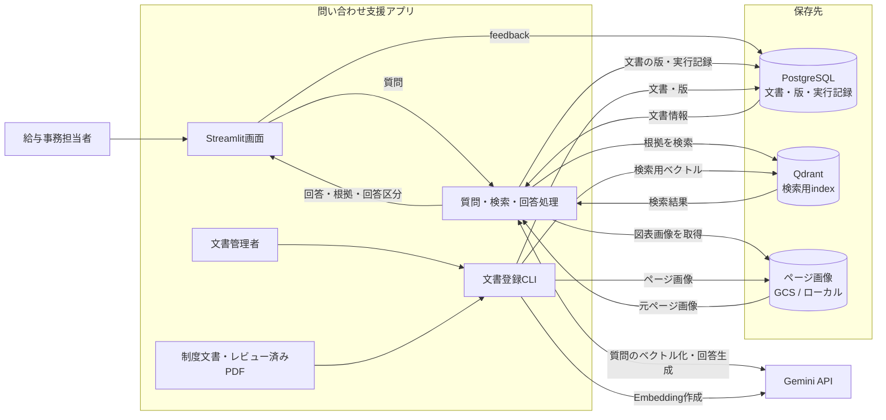
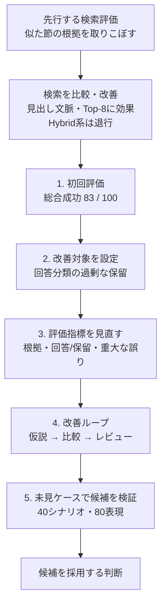

# 自治体の給与事務を支援する、根拠付き問い合わせアプリ

[公開デモ](https://municipal-rag-assistant-280649014820.asia-northeast1.run.app/) · [機能ごとの説明](portfolio/README.md) · [精度改善の詳しい記録](eval/reports/ACCURACY_IMPROVEMENT.md)

## どんな人が、何に使うアプリか

各所属の給与事務担当者や、人事・給与制度を所管する職員が、職員からの制度・手続きの問い合わせに答えるときに使う**調べもの支援アプリ**です。

規程、通知、FAQ、業務マニュアル、申請書の記入例を横断して探し、回答と根拠の場所を一緒に確認できます。たとえば、「給与口座を変更したいときの提出期限は？」「申請書を受け取った後、最初に何を確認する？」といった質問に使います。回答に必要な情報が見つからないときや、個別事情の判断が残るときは、その状態を示します。

制度の最終判断や申請の承認を自動化するものではありません。人事担当者が根拠を確かめ、必要に応じて所管部署へ確認するための補助です。デモでは架空の制度文書だけを使っています。

## このアプリでできること

- **質問する:** 自然な文章で給与制度や手続きについて尋ねる
- **根拠を探す:** 複数の規程・通知・FAQ・手順書に加え、図表の説明も検索する
- **根拠と回答を確認する:** 回答、文書名、版・施行日、ページや見出しを一緒に見る。図表が根拠なら元ページ画像も確認する
- **回答の状態を知る:** 「根拠十分」「判断要」「文書不足」を区別し、回答に対するfeedbackを残す

文書の登録は管理用CLIで行います。一般の利用者がPDFをアップロードして登録する画面はありません。

## アーキテクチャ

画面と検索・回答処理、文書登録、保存先、生成AIサービスを分けています。文書と版、実行記録はPostgreSQLに保存し、Qdrantは再作成できる検索用indexとして使います。

## 精度改善の流れ

初期の実務寄り質問ではRecall@3・@5が1.00でしたが、難問では必要な根拠見出しをすべてTop-5で取得できたのは15問中10問でした。見出し文脈の追加とTop-8で検索を改善し、BM25などを使うHybrid検索は既存質問の退行があったため採用しませんでした。検索方式・スコア統合・複合質問の分割を試した経緯は[検索・版選択の意思決定記録](eval/ACCURACY_IMPROVEMENT_DECISION_REPORT.md)にまとめています。

1. **初回評価:** 未見のText holdoutで総合成功は83/100でした。採点可能な分類不一致12件のうち9件は、根拠のある回答を「判断要」とする過剰な保留でした。
2. **改善対象:** 「根拠がそろっている質問には答え、個別事情で結論が決まらない質問は保留する」ことを狙いにしました。保留を増やすだけでは、見つかった失敗を悪化させるためです。
3. **指標の見直し:** 分類ラベルの一致だけで測らず、既存研究の根拠評価と回答保留評価を参考に、根拠の支持・回答/保留の適切さ・重大な根拠なし断定を分けて採点しました。詳細は[採用判定プロトコル](eval/INTERVENTION_ADOPTION_PROTOCOL.md)に記載しています。
4. **改善ループ:** 失敗の原因から仮説を立て、同じ質問と根拠で旧版・候補を比べ、人手レビューで誤りの種類を確かめました。その結果を次の改善案と評価方法へ戻しました。
5. **候補の検証:** 5文書・40シナリオのholdoutで比較し、事前選定した28ペアを盲検レビューしました。人手評価では候補支持5、従来版支持1でした。レビュー対象では、従来版にあった重大な根拠なし断定2件が候補側では確認されず、この比較を受けて候補を採用する判断に至りました。

この課題指向評価では80表現中52表現が意味面の人手レビュー対象外で、実利用全体への一般化は確認していません。実験条件・採点の限界・個別結果は[評価資料の案内](eval/reports/README.md)から確認できます。

## 詳しく知る

| 内容 | 資料 |
|---|---|
| 画面、文書登録、検索、回答、記録の機能 | [機能ごとの説明](portfolio/README.md) |
| 精度改善の背景と過去の評価結果 | [精度改善の詳しい記録](eval/reports/ACCURACY_IMPROVEMENT.md) |
| 実験条件、採否判断、未実施事項 | [評価資料の案内](eval/reports/README.md) |
| システム構成・データの詳細 | [技術設計](design/TECHNICAL_DESIGN.md) · [データモデル](design/DATA_MODEL.md) |
