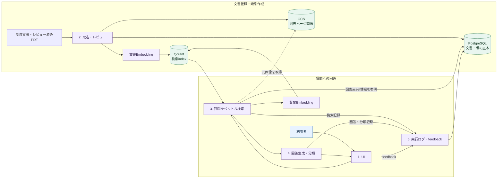

# 自治体向け制度問い合わせ支援RAG

[公開デモ](https://municipal-rag-assistant-280649014820.asia-northeast1.run.app/) · [機能説明](portfolio/README.md)

自治体の給与事務担当者が、規程・通知・FAQ・業務マニュアルから根拠を探す作業を支援するRAGです。架空の制度文書を対象に、回答と根拠、回答できるかどうかを示します。

実在する自治体文書、職員情報、問い合わせ履歴は使用していません。公開デモはCloud Runのscale-to-zero設定により、初回表示に時間がかかる場合があります。

## 仕組み

図中の番号から、各機能の役割・設計上の工夫・評価結果へ進めます。

| 図の役割 | 説明 |
|---|---|
| 1. UI | [質問・回答・根拠の表示](portfolio/01-ui.md) |
| 2. 文書登録・正本管理・ベクトル化 | [取込、レビュー、PostgreSQLとQdrant](portfolio/02-documents-and-index.md) |
| 3. 根拠検索 | [質問ベクトル化と根拠の取得](portfolio/03-retrieval.md) |
| 4. 回答生成・分類 | [根拠付き回答と回答可否の判定](portfolio/04-answer-generation.md) |
| 5. 実行ログ・feedback管理 | [検索・生成・根拠・feedbackの記録](portfolio/05-logging.md) |

[評価結果と詳しいレポート](eval/reports/README.md) · [技術設計](design/TECHNICAL_DESIGN.md)
