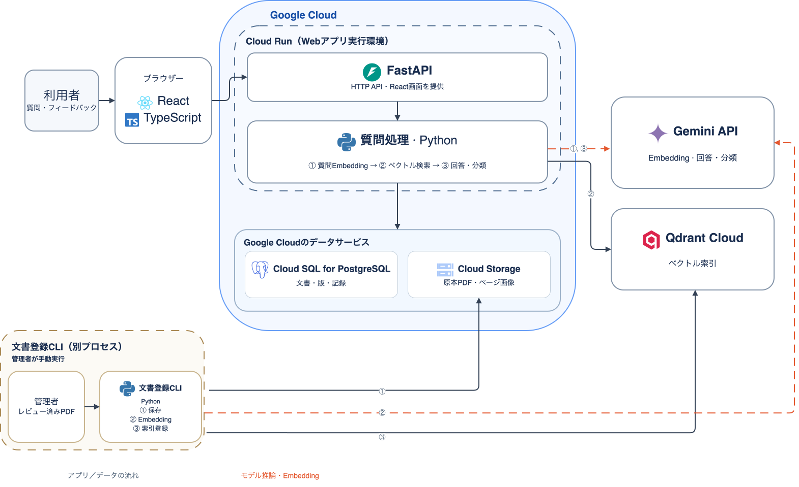
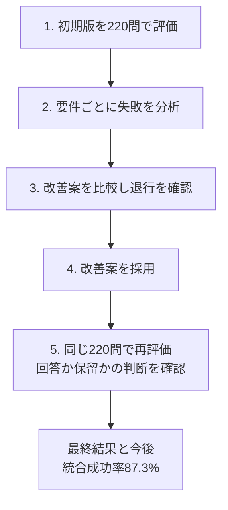

# 自治体の給与事務を支援する、根拠付き問い合わせアプリ

[公開デモ](https://municipal-rag-assistant-280649014820.asia-northeast1.run.app/) · [機能ごとの説明](portfolio/README.md) · [精度改善の詳しい記録](eval/reports/ACCURACY_IMPROVEMENT.md)

## どんな人が、何に使うアプリか

各所属の給与事務担当者や、人事・給与制度を所管する職員が、職員からの制度・手続きの問い合わせに答えるときに使う**調べもの支援アプリ**です。

規程、通知、FAQ、業務マニュアル、申請書の記入例を横断して探し、回答と根拠の場所を一緒に確認できます。たとえば、「給与口座を変更したいときの提出期限は？」「申請書を受け取った後、最初に何を確認する？」といった質問に使います。回答に必要な情報が見つからないときや、個別事情の判断が残るときは、その状態を示します。

制度の最終判断や申請の承認を自動化するものではありません。人事担当者が根拠を確かめ、必要に応じて所管部署へ確認するための補助です。デモでは架空の制度文書だけを使っています。

## このアプリでできること

- **質問する:** 自然な文章で給与制度や手続きについて尋ねる
- **根拠を探す:** 複数の規程・通知・FAQ・手順書に加え、図表の説明も検索する
- **根拠と回答を確認する:** 回答、文書名、版・施行日、ページや見出しを一緒に見る。図表が根拠なら元ページ画像も確認する
- **回答の状態を知る:** 「根拠十分」「判断要」「文書不足」を区別し、回答に対するfeedbackを残す

文書の登録は管理用CLIで行います。一般の利用者がPDFをアップロードして登録する画面はありません。

## アーキテクチャ

React画面から、FastAPIが提供する同一originのAPIを通じて、既存の質問・検索・回答処理を呼び出します。公開APIでは、匿名セッションやリクエストの重複防止、利用回数の上限によってリクエストを管理します。文書とその版、実行記録はPostgreSQLに保存し、Qdrantには必要に応じて再構築できる検索用インデックスを保存します。個人情報の自動マスキングと30日後のデータ削除は今後の対応項目で、まだ実装していません。デモには実在する個人情報や機密情報を入力しないでください。

## 精度改善の流れ

初期版の完成後、制度改定や個別確認、根拠不足、期限・手続などに関する質問を含む220問のセットで評価しました。質問と回答を再確認し、指摘のあった2件を正答として採点し直した結果、初期版の総合回答成功率は76.4%（168/220）となりました。

1. **失敗要因の分析:** 質問と回答を要件別に見直しました。根拠不足への対応を問う18問では3問、個別審査が必要かを判断する24問では14問、多段階の期限・手続を問う24問では16問が成功しました。また、220問中198問で、回答するか保留するかの判断が適切でした。質問文・想定回答・重大誤りの基準も再確認し、初期版では2件を正答に修正しました。修正後の重大誤りは3件でした。これらの結果から、根拠や個別判断の必要性に応じた回答分類と、重大誤りの抑制を改善課題としました。
2. **改善実験と候補版:** 検索、回答生成、回答分類について複数の案を比較しました。既存の質問で退行が見られた案は採用せず、改善案を作成しました。比較の結果、この案を採用し、revision `municipal-rag-assistant-00011-kwv` として現在の公開版に固定しました。
3. **同じ220問で再評価:** 候補版では、220問中218問で回答するか保留するかの判断が適切でした。質問文・想定回答・重大誤りの基準を再確認し、候補版の5件を正答に修正した結果、統合セット全体の総合回答成功率は87.3%（192/220）となりました。質問別では、根拠不足への対応を問う18問中13問、個別審査が必要かを判断する24問中18問、多段階の期限・手続を問う24問中20問が成功しました。
4. **今後の確認:** 新しい制度文書や未使用の質問でも同じ評価規約で評価し、回答分類と全体成功率に同じ改善が見られるか確認します。

その後、採点を再確認した結果、重大誤りは初期版で3件、候補版で0件となりました。質問文・想定回答・重大誤りの基準を見直し、指定のあった計7件を正答に修正しています。元の自動judgeの出力は変更せず、質問ごとの修正内容を追補記録に残しました。

今回の比較では、モデルや回答経路など複数の変更を含むシステム版同士を比べているため、個々の変更の効果は分かりません。また、過去に固定した一部の回答を再利用しており、すべての回答を今回あらためて生成した比較ではありません。この評価はポートフォリオで改善の進め方を説明するためのもので、実際の利用環境で同じ結果になることを示すものではありません。220問の構成、固定した版、質問別スコア、費用と限界は[統合220問評価レポート](eval/results/portfolio-combined-20261115-v1/REPORT.md)に、過去の評価経緯は[評価資料の案内](eval/reports/README.md)にまとめています。

## 詳しく知る

| 内容 | 資料 |
|---|---|
| 画面、文書登録、検索、回答、記録の機能 | [機能ごとの説明](portfolio/README.md) |
| 精度改善の方針と統合220問評価の詳細 | [精度改善の詳しい記録](eval/reports/ACCURACY_IMPROVEMENT.md) |
| 実験条件、採否判断、未実施事項 | [評価資料の案内](eval/reports/README.md) |
| システム構成・データの詳細 | [技術設計](design/TECHNICAL_DESIGN.md) · [データモデル](design/DATA_MODEL.md) |
