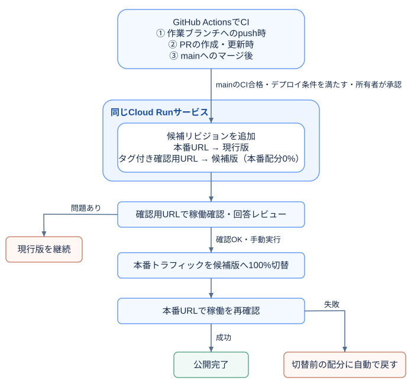
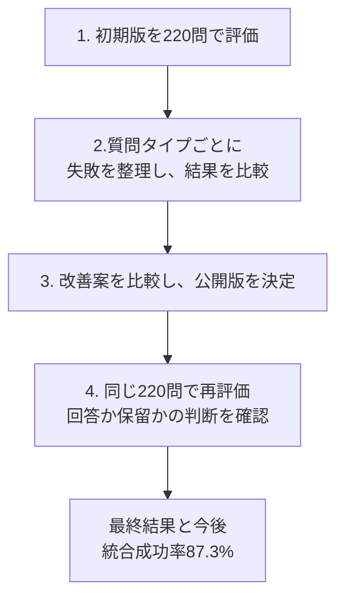

# 自治体の給与事務を支援する、根拠付き問い合わせアプリ

[公開デモ](https://municipal-rag-assistant-280649014820.asia-northeast1.run.app/) · [機能ごとの説明](portfolio/README.md) · [精度改善の詳しい記録](eval/reports/ACCURACY_IMPROVEMENT.md)

## どんな人が、何に使うアプリか

各所属の給与事務担当者や、人事・給与制度を所管する職員が、職員からの制度・手続きの問い合わせに答えるときに使う**調べもの支援アプリ**です。

規程、通知、FAQ、業務マニュアル、申請書の記入例を横断して探し、回答と根拠の場所を一緒に確認できます。たとえば、「給与口座を変更したいときの提出期限は？」「申請書を受け取った後、最初に何を確認する？」といった質問に使います。回答に必要な情報が見つからないときや、個別事情の判断が残るときは、その状態を示します。

制度の最終判断や申請の承認を自動化するものではありません。人事担当者が根拠を確かめ、必要に応じて所管部署へ確認するための補助です。デモでは架空の制度文書だけを使っています。

## このアプリでできること

- **質問する:** 自然な文章で給与制度や手続きについて尋ねる
- **根拠を探す:** 複数の規程・通知・FAQ・手順書に加え、図表の説明も検索する
- **根拠と回答を確認する:** 回答、文書名、版・施行日、ページや見出しを一緒に見る。図表が根拠なら元ページ画像も確認する
- **回答の状態を知る:** 「根拠十分」「判断要」「文書不足」を区別し、回答に対するfeedbackを残す

文書の登録は管理用CLIで行います。一般の利用者がPDFをアップロードして登録する画面はありません。

## アーキテクチャ

React画面から、FastAPIが提供する同一originのAPIを通じて、既存の質問・検索・回答処理を呼び出します。公開APIでは、匿名セッションやリクエストの重複防止、利用回数の上限によってリクエストを管理します。文書とその版、実行記録はPostgreSQLに保存し、Qdrantには必要に応じて再構築できる検索用インデックスを保存します。個人情報の自動マスキングと30日後のデータ削除は今後の対応項目で、まだ実装していません。デモには実在する個人情報や機密情報を入力しないでください。

## CI/CDと公開手順

図の編集には[draw.ioソース](ci-cd.drawio)を使用します。

CIはGitHub Actionsが自動で実行します。変更を`main`に取り込むかはPRの差分とCI結果をレビューして人が判断します。本番に公開するかは、候補版の稼働と回答内容を確認したうえで別に判断します。

[CIの検査項目と公開手順の詳細](design/CI_CD_AND_RELEASE.md)

## 精度改善の流れ

### 1. 失敗要因の分析

初期版は220問中 **168問で成功（76.4%）** し、**52問が総合成功の条件を満たしませんでした（23.6%）**。初期版の結果を、成功率の低い順に示します。

| 評価区分 | 成功件数 | 成功率 | 失敗件数 |
|---|---:|---:|---:|
| 根拠不足への対応 | 18問中3問 | 16.7% | 15問 |
| 個別審査の要否 | 24問中14問 | 58.3% | 10問 |
| 多段階の期限・手続 | 24問中16問 | 66.7% | 8問 |
| 複数文書・複数条件 | 30問中21問 | 70.0% | 9問 |
| 改定・施行日の境界 | 24問中20問 | 83.3% | 4問 |
| 標準質問 | 100問中94問 | 94.0% | 6問 |
| **合計** | **220問中168問** | **76.4%** | **52問** |

失敗件数が多かった「根拠不足への対応」と「個別審査の要否」を重点課題にしました。根拠が足りないときに回答を保留し、個別の確認が必要かを適切に判断できるよう改善する必要があると判断しました。

このRAGは人事・給与に関する規則や通知の確認に使うため、文書の根拠を超えて断定しないことも重視しました。そのため、根拠のない断定は、発生件数にかかわらず改善対象にしました。

### 2. 改善案を比較し、公開版を決定

検索・回答生成・回答分類の改善を試し、初期版で正答できていた質問に新たな誤答が出る案は候補から外しました。回答生成モデルは、Flash-Liteに比べて推定費用が約10.8倍、平均応答時間が約5.5倍でも、保留すべき質問への誤回答や重大誤りが少なかったGemini 3.8 Flashを選びました。[モデル選択記録](eval/reports/GENERATION_MODEL_SELECTION_20261019.md)

次に、質問と根拠文書を固定した開発用176問で、回答指示（プロンプト）の変更案を比較しました。

| 改善案 | 改善したい点 | プロンプトで変えた指示 | 成功件数・成功率 | 推定評価費用 | 判断 |
|---|---|---|---:|---:|---|
| A. 回答を短く完結させる | 回答の途中切れ、資料が食い違う場合の断定 | 背景説明や重複を省き、結論・根拠・案内を優先。資料が矛盾するときは相違点を示し、所管部署への確認を案内する | 159/176（90.3%） | 2.60 USD | 不採用。重大誤り3件 |
| B. 複合質問に項目別に答える | 質問の一部にしか答えない | 質問に複数の事項や条件があれば、一つずつ答え、根拠から確認できる点と確認できない点を示す | 171/176（97.2%） | 3.41 USD | Cの土台にした |
| C. 項目ごとの結論と根拠を簡潔に示す | 複合質問で結論が埋もれる、説明が重複する | Bの指示を具体化し、各項目の結論と必要な根拠を短く示す。確認できない点も明記し、重複を省く | 172/176（97.7%） | 3.41 USD | Dに引き継いだ |
| **D. 表の備考・上限・例外も拾う** | 表の本体だけを読み、適用条件を見落とす | Cに加え、表や図表にある備考・上限・例外条件も、質問に関係すれば回答に含める | **173/176（98.3%）** | **3.41 USD** | **採用。重大誤り・保留対象への誤回答ともに0件** |
| E. 届出案内に必要な項目を指定する | 届出の期限や添付書類が抜ける、記入例を別の事由にも当てはめる | Dに加え、届出名・期限・添付書類・対象事由を分けて示し、記入例は該当する事由に限って案内する | 173/176（98.3%） | 3.42 USD | 不採用。重大誤り・保留対象への誤回答が各1件 |
| F. 資料の不一致や条件不足を明示する | 資料が食い違う場合や必要な情報が足りない場合に結論を断定する | Dに加え、確認できる範囲と不一致・不足点を示し、判断を保留して所管部署への確認を案内する | 169/176（96.0%） | 3.42 USD | 不採用。重大誤り・保留対象への誤回答は0件だったが、Dより成功が4問少なかった |

費用は各案の176問の評価にかかった推定額です。Aは回答の出力上限が1,024トークン、B〜Fは2,048トークンでした。[プロンプト案の比較記録](eval/results/autoresearch/results.tsv)

**採用したのはDです。** Eと同じ173問で成功し、重大誤りと保留すべき質問への誤回答がともに0件だったため、Dを採用候補にしました。候補単独の未使用質問での評価は事前基準に届かず、最終判断では当時の公開版との匿名比較も確認しました。そのレビューでは候補を支持する所見が5組、当時の公開版を支持する所見が1組でした。選定したモデル・回答経路・Dのプロンプトを組み合わせた構成が、採用した公開版です（revision `municipal-rag-assistant-00011-kwv`）。[採用判断の記録](eval/reports/ACCURACY_IMPROVEMENT_DECISION_20261101.md)

### 3. 改善案Dを組み込んだ公開版を再評価

改善案Dを選定済みのモデル・回答経路と組み合わせた公開版を、初期版と同じ220問・同じ採点基準で評価しました。

| 評価項目 | 初期版 | 公開版 | 改善幅 |
|---|---:|---:|---:|
| **総合回答成功率** | **168/220 (76.4%)** | **192/220 (87.3%)** | **+24問 (+10.9pt)** |
| 回答・保留の適切さ | 198/220 | 218/220 | **+20問 (+9.1pt)** |
| 根拠不足への対応 | 3/18 | 13/18 | **+10問 (+55.6pt)** |
| 個別審査の要否の判断 | 14/24 | 18/24 | **+4問 (+16.7pt)** |
| 多段階の期限・手続 | 16/24 | 20/24 | **+4問 (+20.8pt)** |

ptはパーセントポイントを表します。改定・施行日の境界では、20/24から19/24に低下しました（−1問、−4.2ポイント）。

質問文・想定回答・重大誤りの基準を再確認し、初期版の2件と公開版の5件を正答に修正しました。修正後の重大誤りは初期版3件、公開版0件でした。元の自動採点は保持し、修正内容は質問別に記録しています。

改善幅はモデル・回答経路・プロンプトの変更を含む版全体の差です。改善案D単独の効果は未測定です。一部の質問では保存済みの回答を再利用しました。実際の利用環境で同じ結果が得られるかは未検証です。評価条件、質問別スコア、費用、評価の限界はレポートにまとめています。[統合220問評価レポート](eval/results/portfolio-combined-20261115-v1/REPORT.md)

### 4. 今後の展望

未使用の質問や制度文書でも改善が再現するかを、表現や制度の異なるケースで確かめます。根拠のない断定を避けながら、根拠不足への対応や個別審査の要否判断など、失敗が残る領域を改善します。

過去の評価経緯は資料一覧から確認できます。[評価資料の案内](eval/reports/README.md)

## 詳しく知る

| 内容 | 資料 |
|---|---|
| 画面、文書登録、検索、回答、記録の機能 | [機能ごとの説明](portfolio/README.md) |
| 精度改善の方針と統合220問評価の詳細 | [精度改善の詳しい記録](eval/reports/ACCURACY_IMPROVEMENT.md) |
| 実験条件、採否判断、未実施事項 | [評価資料の案内](eval/reports/README.md) |
| システム構成・データの詳細 | [技術設計](design/TECHNICAL_DESIGN.md) · [データモデル](design/DATA_MODEL.md) |
