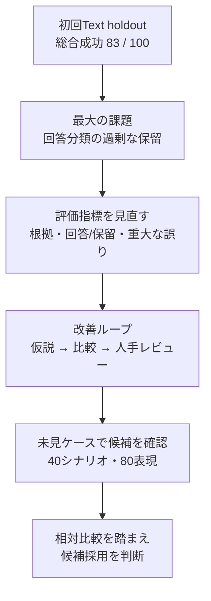

# 初回評価から回答保留の評価・候補判断まで

この資料は、[トップREADMEの精度改善フロー](../../README.md#精度改善の流れ)を詳しく説明します。どの失敗を優先し、なぜ評価指標を見直し、どのような比較を経て候補を判断したかをまとめます。個別実験の全条件・出力は、末尾の評価記録を参照してください。

## 改善の流れ

## 先行する検索品質の検証

検索品質を改善対象にしたのは、簡単な質問だけでは根拠の取りこぼしが見えなかったためです。初期の実務寄り質問ではRecall@3・@5がともに1.00でしたが、難問評価では必要な根拠見出しをすべてTop-3で取得できたのは8/15、Top-5でも10/15でした。主な弱点は文書を見つけることより、同じ文書内の似た節から必要な見出しを上位に出すことでした。130問の開発評価では検索失敗は13失敗中3件で、回答生成6件・分類4件より少数でしたが、根拠検索の取りこぼしを独立して改善できるかを試しました。

| 試した方法 | 結果と判断 |
|---|---|
| 文字2・3-gram TF-IDFとRRFによるHybrid検索 | 難問の全根拠見出しHit@5は10/15から12/15へ改善しましたが、既存の実務質問で文書Hit@3が16/16から15/16へ低下したため、公開経路には採用しませんでした。[難問検索評価](../HARD_EVALUATION.md) |
| Embedding profileの比較 | Gemini Embedding 001、Gemini Embedding 2、Ruri v3の全根拠見出しHit@5はそれぞれ74/88、72/88、74/88でした。MRRも最良だった既存のGemini Embedding 001を維持しました。[Embedding比較](../EMBEDDING_MODEL_EVALUATION.md) |
| 文書名・親見出しをEmbedding入力へ追加 | 同じ節を区別しやすくなり、全根拠見出しHit@5は74/88から78/88、節の取りこぼしは11件から7件へ改善したため、後続の基準構成に採用しました。[Contextual heading評価](../CONTEXTUAL_HEADING_FORMAL_EVALUATION.md) |
| 検索件数をTop-5からTop-8へ増加 | 対象8問で必須内容一致が6/8から8/8になりました。Generator入力tokenは57.8%、概算費用は36%増えましたが、Top-8を基準構成に採用しました。[Top-k回答比較](../GEMINI_3_1_TOP_K_ANSWER_EVALUATION.md) |
| Sudachi BM25とdense検索をRRFで統合 | 対象の検索失敗3件は改善せず、全根拠見出しHit@5が80/90から73/90へ低下し、既存成功8件が退行したため不採用でした。[BM25 Hybrid評価](../BM25_HYBRID_EVALUATION.md) |
| 複合質問を論点ごとに分けてdense検索 | Evidence Hit@5は80/90から82/90へ改善し、Q291・Q436の根拠を取得しました。ただしQ291は回答で旧版を選び、Q436は比較元のAPI障害で回答のpaired比較が成立しなかったため、検索単体では本番採用を判断していません。[Query Decomposition評価](../QUERY_DECOMPOSITION_EVALUATION.md) |

Hybrid検索では、密ベクトル類似度とBM25の生スコアを直接足さず、別々の検索順位をRRF（k=60）で統合しました。BM25側はSudachi SplitMode C、k1=1.2、b=0.75を使い、dense・sparseそれぞれ上位20件を候補にしました。確認した資料に生スコアの加重和や閾値調整の比較はありません。各試験は評価セットが異なるため、数値を一つの精度推移としては扱いません。

## 1. 初回評価で見つかった課題

開発に使っていないText sealed holdoutは、50シナリオ・100表現で総合成功83/100でした。分類不一致は14件、回答内容の失敗は6件、実行失敗は2件、文書・根拠検索の失敗は0件でした。失敗原因は重複するため、件数を足して総合失敗数とはしません。

分類不一致のうち採点可能な12件を見ると、9件は根拠のある回答を「判断要」とする過剰な保留でした。内容面では具体的な期限を求められても、根拠にある日数だけを示して日付を答えない失敗が目立ちました。

このため、検索だけを改善しても主な課題は解決しないと判断し、まず「回答できる質問に適切に答え、個別条件の判断が必要な質問では保留する」挙動に焦点を移しました。

**先行する開発評価との関係:** これ以前に、開発用130問では117/130から120/130へ改善し、退行0件を確認しています。この開発評価と、後の83/100 holdoutは異なる質問集合・目的の結果です。前段の改善は[検索・版選択の意思決定記録](../ACCURACY_IMPROVEMENT_DECISION_REPORT.md)にまとめています。

## 2. 指標を見直した理由

分類ラベルの一致率だけでは、回答を保留する判断が適切だったかを十分に評価できません。保留を増やせば危険な断定は減るかもしれませんが、根拠がある質問への過剰な保留を増やすこともあります。そこで、回答と保留の両方を別々に確認することにしました。

| 評価すること | 確認する失敗 |
|---|---|
| 根拠による支持 | 回答の主張が、取得した文書や検証済み計算に支えられているか |
| 回答・保留の適切さ | 答えられる質問を過剰に保留していないか。判断材料が足りない質問へ断定していないか |
| 重大な根拠なし断定 | 根拠の範囲を超え、規則や要件の不存在などを断定していないか |

この分け方は、根拠に支えられた回答を測る[GaRAGe](https://aclanthology.org/2025.findings-acl.875/)と、回答可能・不可能な質問への応答を分けて評価する[abstention評価研究](https://aclanthology.org/2025.coling-main.627/)を参考にし、給与制度の問い合わせに合わせて調整しました。たとえば、回答可能な質問に対する**過剰保留率**、保留すべき質問への**危険な断定率**、回答対象の**coverage**、回答した範囲の誤りを別々に見ます。研究との対応、指標定義、採否に使う評価手順は[採用判定プロトコル](../INTERVENTION_ADOPTION_PROTOCOL.md)に記載しています。

## 3. 改善ループ

評価結果を見て一度に多くを変更するのではなく、失敗の原因ごとに候補を作り、次の順で確認しました。

1. 失敗から改善仮説を立てる。
2. 候補を固定し、同じ質問・根拠を使って比較する。
3. 既知の失敗だけでなく、既存の成功例や異なる表現での退行も調べる。
4. 自動評価の差が出た回答を人が確認し、内容・根拠・回答または保留の適切さを判定する。
5. 結果を次の候補と評価方法へ反映する。効果や安全性が確認できない候補は採用しない。

開発用176件では候補のmachine scoreが173/176でした。80表現のchallengeでは候補77/80、比較対象76/80で、差は小さく、これらだけを未知ケースへの一般化の証拠とはしません。

## 4. 未見ケースでの候補比較と判断

候補と現行版を同じ質問集合で比べるため、5文書・40シナリオ・80表現のpaired holdoutを使いました。評価前に選んだ28ペアを方式名を伏せて人手レビューし、回答内容、根拠の範囲、回答または保留の適切さを比較しました。この比較は`japanese-e2e-full-system-paired-20261026-02`で、評価setは`japanese-e2e-rag-holdout-20261026-02`です。候補はcommit `e9d626099c32eec771c4abc47d108337e9afdafb`、prompt SHA-256 `cae1bafc46a98a30670f6e32c79508514a25580d80ba8f2a5d370e63a786ac0d`、比較対象は公開revision `municipal-rag-assistant-00009-j49`（commit `112434860e50abf0773a083f53ad01cf9334ac9b`）でした。判断とレビュー範囲の要約は[2026-11-01の候補採用記録](ACCURACY_IMPROVEMENT_DECISION_20261101.md)を参照してください。

人手レビューでは重大な根拠なし断定と回答・保留の適切さを主軸にし、事実性・網羅性、根拠・引用、版・時点、日本語の明瞭さ、実行上の問題も記録しました。レビュー定義は盲検レビューpacket SHA-256 `c48da2a85e1af7c1f8f1db6462ad01e984022e2085ee336d43e5174dcfbcb0da`で識別しています。packet本文やsealed dataは公開資料に含めていません。採用判定の一般条件は[採用判定プロトコル](../INTERVENTION_ADOPTION_PROTOCOL.md)にあります。

- 方向性のある人手評価は、候補支持5ペア、現行版支持1ペアでした。文体の好みだけによる支持は、品質改善に数えていません。
- レビューしたペアでは、現行版に重大な根拠なし断定があった2件について、候補は根拠の範囲内に留まりました。
- 候補が一般要件を十分に伝えず、現行版の方が望ましいとされたケースも残りました。
- 80表現のうち52表現は意味面の人手レビュー対象外です。補助的な分類一致率の差も注釈に敏感なため、単独の採用根拠にはしていません。

この比較は「候補がすべての基準を満たしたか」ではなく、「現行版と比べ、重大な根拠なし断定を防ぎ、回答・保留を適切にできるか」を見る相対評価でした。結果と残るリスクを踏まえ、ユーザーは候補を採用する判断をしました。これは40シナリオの課題指向評価に基づく判断であり、実利用全体への一般化を示すものではありません。

なお、候補だけを評価した別の100表現holdoutは76/100で、当時の事前設定された絶対gateを満たしませんでした。この結果はそのgateでのNo-goとして保持されています。後のpaired比較とは質問集合・評価目的・判定方法が異なるため、成績を合算したり、相対比較を絶対gateの合格と読み替えたりしません。詳しい条件は[評価資料の案内](README.md)を参照してください。

## 5. 数値の読み方と主張できる範囲

- 開発用130問の117/130から120/130への変化は、同じ開発評価内での改善です。
- 初回Text holdoutの83/100は、別の質問集合で見つかった未見課題を示します。
- 候補の開発score、challenge、candidate-only holdout、paired holdoutは、set・比較方法・採点基準が異なります。単一の精度推移としてつなげません。
- 最新paired holdoutは5文書・40シナリオの課題指向評価であり、実利用での成功率や、未見の制度文書全般への一般化は推定していません。
- 人手レビューは28ペアに限られ、残りの表現が問題なかったことを意味しません。

## 詳細な実験記録

- [回答保留評価の仕様・結果・過去の判断](PORTFOLIO_EVALUATION_AND_IMPROVEMENT_HISTORY_20261017.md)
- [汎化検証の方針](../GENERALIZATION_VALIDATION_PLAN.md)
- [候補の採用判定手順と評価条件](../INTERVENTION_ADOPTION_PROTOCOL.md)
- [前段の開発評価で採用・不採用にした検索・版選択の施策](../ACCURACY_IMPROVEMENT_DECISION_REPORT.md)
- [評価手法の仕組みと成立条件](ACCURACY_METHODS_TECHNICAL_GUIDE.md)
