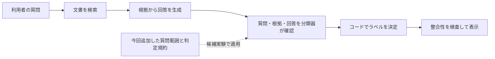

# RAGの分類改善を理解する：質問の対象と判定規約をLLMへ伝える

作成日：2026年10月9日

**今回の改善は、実験用の候補として実装・比較検証済みで、本番には適用していない。** 既知の20表現では分類・表示成功が15件から20件へ増えた。一方、本番適用に必要な未知の問題での検証と、回答生成の失敗を正しく扱う設計が残っている。

追記：本番受入準備では、対象ごとの規則・主張支持・回答充足を分ける実装へ進めたが、独立レビューで版解決後の表示不整合が見つかり採用を停止した。安全停止の修正版はローカルの関連73テストと独立レビューで確認し、未知評価・holdout・本番適用は未実施。[後続作業の記録](../results/scope_release_gate1_20261009/report.md)を参照。以下の20/20は初期のプロンプト比較だけの結果である。

追加対応：版解決後の回答を一度だけ再検証する処理を実装し、正しい回答の表示と不完全回答の非表示を既知4条件の実LLM試験で確認した。関連85テスト通過。これは未知ケースやホールドアウトの合格ではない。[修正結果](../results/scope_revalidation_v22_20261009/report.md)を参照。

2026年10月12日追記：後続の構造化候補v2.2は全56試験の比較を完了し、既知20表現で旧16件・候補15件となった。シナリオ1改善・3退行でGate 1不合格。以下の初期プロンプト実験の20/20と混同しない。[修正版の比較結果](../results/scope_release_v22_gate1_final_20261012/report.md)を参照。

初めてRAGを学ぶ人は1〜4節で仕組みと具体例を、実装を確認したい人は5〜8節で比較方法・コード・残る課題を確認できる。この資料は架空の自治体制度を扱う本リポジトリの説明であり、実在する制度の判定資料ではない。

## 1. RAGの「回答」と「分類」は別の処理

RAGは、質問に関係する文書を検索し、その文書を材料としてLLMが回答する仕組みである。本アプリは回答を作った後に、その回答を利用者がどう扱うべきかも判定する。



分類器もLLMだが、回答を書く役割ではなく、回答と根拠の関係を確認する役割を持つ。分類結果から、コードが「根拠十分」「判断要」「文書不足」というラベルを決める。

| 表示ラベル | このアプリで伝えたい意味 |
|---|---|
| 根拠十分 | 質問の結論を取得根拠と入力条件から支持でき、必要な未確認事項が残らない |
| 判断要 | 判断基準はあるが、質問の結論を決める個別事実の確認・裁量・版競合が残る |
| 文書不足 | 質問に必要な規則や判断基準を、今回取得した根拠では確認できない |

これは目指す分類の意味である。現行の決定コードには、後述する生成失敗を「文書不足」として扱う問題がある。

文書が見つかり回答内容も正しいのに、分類器が不要な「個別確認」を付けることがある。この状態を本資料では**過剰保留**と呼ぶ。反対に、本当に確認が必要なのに確定済みと扱う誤りも避けなければならない。

## 2. 問題は「何について判断するのか」が曖昧だったこと

例えば、文書に「支給には個別記録の照合が必要」と書かれているとする。

「誰が照合しますか」という質問なら、文書に担当部署が書かれていれば回答できる。「この職員に支給できますか」という質問なら、照合結果が分からなければ個別の結論は決められない。同じ文書を読んでも、質問の対象によって必要な確認は変わる。

今回、分類器に次の区別を明示した。

| 質問が求めるもの | 例 | 判定する対象 |
|---|---|---|
| 一般規則・権限・確認先 | 「所属部署だけで支給を決められますか」 | 所属部署の権限についての規則 |
| 条件付き算定 | 「条件を満たすと仮定した場合、補填額はいくらですか」 | 仮定された条件の下での計算結果 |
| 個別の結論 | 「この職員への支給額を確定できますか」 | 特定の職員に実際に適用する結論 |

これは利用者向けの新しい3分類ではなく、**既存の分類を行う前に、質問の意味を読むための区別**である。コードが特定の単語を見て機械的に振り分ける実装もしていない。「確定できますか」という言葉だけでは、権限の質問か、個別案件の質問かを決められないためである。

## 3. 分類器へ何を追加したのか

旧指示は、主に「5つの判定要因をJSONで返す」「文書全体に答えが存在するかは判定しない」という内容だった。JSONは、プログラムが読めるように項目名と値を並べた形式である。

出力項目の名前はあったが、それぞれをどの意味で判断するかの説明が不足していた。候補では、まず質問が直接求める結論を特定するよう伝え、その対象に次の規約を適用するようにした。

| 判定項目 | 平易な意味 | 候補が注意させる境界 |
|---|---|---|
| `retrieval_sufficient` | 必要な規則・判断基準が取得根拠にあるか | 関連文書があるだけでは十分としない |
| `answer_fully_supported` | 回答の重要な主張を支持でき、要求された項目にも答えているか | 引用があるだけ、質問の一部に答えただけでは十分としない |
| `requires_case_facts` | 結論を変える個別事実が不足しているか | 質問に書かれた確認済みの事実を、再び不足扱いしない |
| `requires_policy_judgment` | 文書が人による裁量・解釈を残しているか | 規則に従って計算することと、人による裁量を区別する |
| `version_conflict` | 適用する文書の版を一意に選べないか | 複数の版があるだけでは競合としない |

質問の日付・金額・状態は、文書の規則へ当てはめる**入力値**である。質問に金額が書かれているだけで、その金額の制度上の正しさが保証されるわけではない。生成回答も正解として信用せず、根拠に照らして確認する。

この方法は、LLMに渡す指示文を変更するプロンプト改善である。今回はモデルを追加学習せず、検索方法・根拠・生成回答・出力形式も両方式で固定した。ラベルをコードで決定する処理も同じものを使った。

`answer_fully_supported`に主張の支持と回答の充足をまとめた点には限界が残った。表の定義は候補への指示であり、全応答がその定義を完全に守ったという意味ではない。

## 4. 実際に改善した例

### 確認済みなのに確認を求めていた例

評価例C01では、文書に「承認された交換用電池代の50%を補填、上限8,000円」「資産台帳と領収書を照合して確定」とある。質問には、購入額12,000円、承認済み、照合済みが明記されていた。

固定した生成回答は6,000円と正しく答えていたが、旧指示の分類器は追加の個別確認を要求して「判断要」にした。候補は確認済みの条件を使い、`requires_case_facts=false`として「根拠十分」にした。

ここでは回答の計算を直したのではなく、**正しい回答を不要に保留していた分類を直した**。

### 別契約が必要なのに根拠十分としていた例

評価例C04の質問は、修理費の実際の自己負担率を尋ねていた。取得文書には「率は別の保守契約で定める」とあるだけで、その率自体はなかった。

旧指示は「別契約による」と説明できることを十分とし、「根拠十分」を返した。候補は、求められた率を決める根拠がないため`retrieval_sufficient=false`とした。

なお、旧指示の出力は不足条件とラベルが矛盾し、表示処理で停止していた。誤った支給率が利用者の画面に表示された実例として扱ってはいけない。

必要な確認をすべて消したわけでもない。記録が未照合の個別案件3シナリオ・6表現は、候補でも「判断要」を維持した。

## 5. どうやって効果を確かめたのか

同じ質問でも、検索結果や生成回答が変われば分類結果は変わり得る。そこで今回は、質問・根拠・生成回答を一組として保存し、同じ一組を旧指示と候補指示に渡した。このように条件を揃えた比較を**対応のある比較**と呼ぶ。

```text
同じ質問 ＋ 同じ根拠 ＋ 同じ生成回答
    ├─ 旧分類指示 → 5要因 → 同じ決定・表示処理
    └─ 候補の指示 → 5要因 → 同じ決定・表示処理
```

旧指示も今回新しく実行した。以前保存された旧モデルの成績を、今回の候補の対照として代用していない。

| 用途 | 件数と呼出し数 |
|---|---|
| 既知問題 | 10シナリオ×2表現×2方式＝40回 |
| 診断用の対照 | 裁量・版競合・誤った金額・未回答項目の4例×2方式＝8回 |
| 再実行による確認 | 事前に選んだ4表現×2方式＝8回 |
| 合計 | 56回。API・schema error 0、retry 0 |

分類モデルは両方式ともGemini 3.1 Flash Lite、温度0、seed42、最大出力1024token。固定した生成回答は、以前のGemini 3.5 Flash Liteによる出力を再利用した。これは分類部分を切り出すための条件であり、現在のアプリ全体を動かした試験ではない。

一つのシナリオには標準表現と言い換えがある。似た言い方を別々の独立した問題として水増ししないよう、両表現に成功したシナリオ数も数えた。正解の解釈が曖昧だったA01/B01は実行前に除外した。候補・入力・正解条件・実行上限も実行前に固定し、結果を見て書き換えていない。

## 6. 結果と、その読み方

| 指標 | 旧指示 | 候補 |
|---|---:|---:|
| 既知20表現のラベル一致＋表示成功 | 15/20 | 20/20 |
| 両表現に成功したシナリオ | 7/10 | 10/10 |
| 診断4例の全判定項目一致 | 2/4 | 4/4 |

シナリオ単位では、両方式成功7、候補だけ成功3、旧指示だけ成功0、両方式失敗0。表現単位では改善5、退行0だった。候補の反復対象4表現も、初回・追加実行の両方で成功した。

したがって「今回の既知問題では、規約を明示する候補が改善した」と説明できる。ただし「RAG全体の正答率が100%になった」とは説明できない。検索も生成も固定しており、未知の質問はまだ測っていない。また、指示には複数の説明を同時に追加したため、どの一文が効いたかも分からない。

コスト面では、各方式28回の入力tokenが16,572から37,628へ約2.27倍になった。tokenはモデルが処理する文章量の単位である。API単体の時間中央値は1.42秒から1.52秒だった。これは検索・生成・待ち時間を含むアプリの応答時間ではない。料金の管理仮定と詳細は[実験レポート](../results/classification_scope_policy_v1_20261009/report.md)に記録した。

## 7. エンジニア向け：実装と監査の入口

候補は既存のprompt builderが作る文字列の前に規約を付ける。概念的には次の処理である。

```python
candidate_prompt = scope_policy + "\n" + baseline_prompt(
    question, retrieved_evidence, generated_answer
)
```

別のLLMで質問を分解する処理や、質問ごとの特例は追加していない。判定対象を専用の構造化fieldで返させてもいないため、対象抽出そのものの精度を独立して監査できる段階ではない。

| 資料・実装 | 確認できること |
|---|---|
| [候補の指示本文](../../src/classification_scope_policy.py) | 実際にLLMへ渡す規約とprompt builder |
| [比較runner](../evaluate_classification_scope_policy.py) | 入力固定、方式順、実行上限、採点と表示確認 |
| [候補設計](../../design/CLASSIFICATION_SCOPE_POLICY_CANDIDATE.md) | 変更対象、事前に定めた進行条件、残る制約 |
| [manifest](../results/classification_scope_policy_v1_20261009/manifest.json) | モデル・予算管理条件・各ファイルのhash |
| [tasks](../results/classification_scope_policy_v1_20261009/tasks.json) | 正解情報を含めない、実際の完全な入力prompt |
| [records](../results/classification_scope_policy_v1_20261009/records.jsonl) | 全56回の応答・判定・使用token・時間 |
| [分析結果](../results/classification_scope_policy_v1_20261009/analysis.json) | 方式ごとの結果、例別factor、反復の一致 |
| [意味確認](../results/classification_scope_policy_v1_20261009/semantic_review.json) | ラベル一致だけでは見えない残存問題 |
| [テスト](../../tests/test_classification_scope_policy.py) | 入力不変、正解情報の非混入、表示契約、危険な確定等 |

hashはファイル内容を識別する値で、比較中に入力やコードが変わっていないかの確認に使った。生成回答や正解ラベルを事後に変更して成功数を増やすことを防ぐための記録である。

関連するローカルテスト43件と、追加Python 4ファイルの静的検査は通過した。テストはプログラムの契約を確認するもので、LLMの分類精度を保証するものではない。評価資料の作成・実装・今回の意味確認は同じ担当であり、独立レビュー済みとも扱わない。

## 8. 本番未適用の理由と、次に必要な作業

### コードの接続状態

2026年10月9日時点で、[アプリの組み立て処理](../../src/rag_v2.py)は今回の候補を呼んでいない。通常のv1経路は従来の分類指示、期限用の経路は期限用指示を使う。今回の候補を選ぶのは比較runnerである。

`CLASSIFICATION_CONTRACT_VERSION=v2`は以前のQuestion Contract v2候補を選ぶ設定で、今回の指示を有効にする設定ではない。今回の作業で本番設定の変更やデプロイは行っていない。この確認はローカルコードと作業記録に基づき、稼働中の本番サーバーを照会したものではない。

### 正しいラベルでも、内部の判断が完全とは限らない

「単価と提出先」を聞かれて、回答が単価しか述べていない場合を考える。単価の説明は根拠に支持されていても、回答全体としては不足している。

今回の候補はこの診断例を検出した。しかし現行の決定コードでは、回答が不完全な場合も「文書不足」へ進む。根拠に提出先があるのなら、原因は文書不足ではなく回答生成の失敗である。この診断例は内部項目の検出を成功と数え、文書不足という表示を正解にはしていない。

また、文書不足の6表現では、候補も`answer_fully_supported=true`を返した。うち2表現は回答の主張自体が空だった。根拠不足の判定が優先されて最終ラベルは正しくなったが、主張の支持・回答項目の充足・回答なしを一つのbooleanで表す限界が残る。

次の実装では、少なくとも次を分けて観察する必要がある。

| 観察すること | 例 |
|---|---|
| 質問が求める対象 | 単価と提出先 |
| 取得根拠に必要な規則があるか | 両方とも文書にある |
| 回答の各主張を支持できるか | 単価の主張は正しい |
| 質問の各項目に答えたか | 提出先の回答がない |
| 個別の確認や裁量が残るか | この一般規則の質問では残らない |

この結果から、生成不足を`GENERATION_INCOMPLETE`のような内部状態として分離し、表示や回復処理につなぐ。上表は次の設計方針であり、今回新たに実装したschemaではない。

その後、条件付き算定と個別確定の境界を含む未使用の問題で比較し、既存問題への退行、検索から表示までの動作、費用・速度を確かめる必要がある。最終採用には、候補固定後に初めて使う評価セットも必要になる。詳細は[採用判定プロトコル](../INTERVENTION_ADOPTION_PROTOCOL.md)に従う。

## 9. ポートフォリオでの説明例

> RAGの検索後に回答を分類する処理を調べ、質問が求める結論と、関連する実務上の確認事項が混同されていることを確認しました。質問の対象と5つの判定項目の定義を分類器へ明示する候補を作り、質問・根拠・生成回答を固定して旧指示と比較しました。既知20表現では15件から20件に改善し、退行はありませんでした。一方、回答の根拠支持と回答項目の充足を同じ項目で判断する限界が残ったため、本番適用はせず、状態分離と未知問題での検証が必要だと判断しています。

この説明では、観測した問題、選んだ手法、比較条件、改善結果、残る限界、採否を一続きで伝えられる。実験で有望だったことと、本番で改善を達成したことを区別して説明する。
