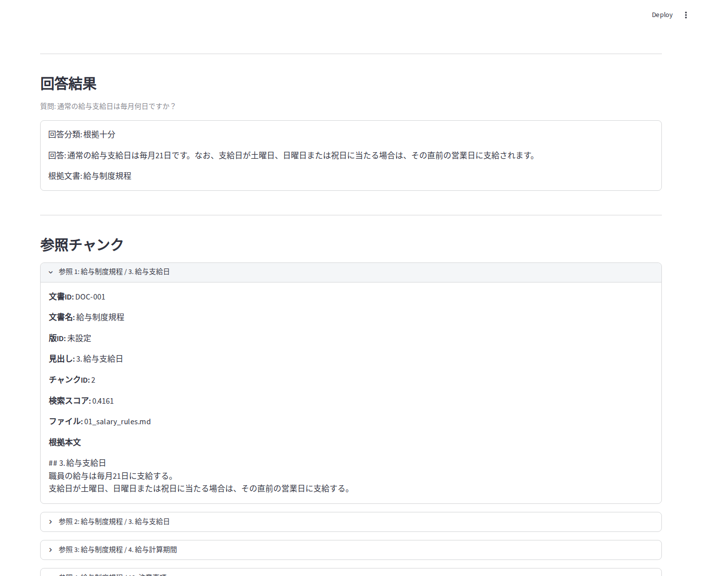
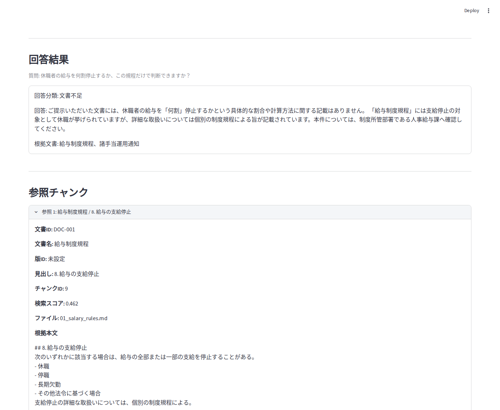

# 1. UIで質問と回答を扱う

[READMEの構成図へ戻る](../README.md#仕組み) · [機能一覧へ](README.md)

## 1. 機能の概要

Streamlitで制度・手続きの質問を受け付け、回答、回答区分、参照した根拠本文、文書の版情報、図表のページ画像を表示します。利用者は回答へのfeedbackも送れます。回答だけでなく、原文と出典の版を画面上で確認できます。

## 実画面の例

以下は**保存済み応答を現在の実UIへ再生した画面**です。撮影日は2026-10-25、UIはcommit `912f095130bfbd73bd9599cee25c6ff65bb91e75`の`app.py`（本作業で変更なし）を使用しました。応答は2026-09-23に`gemini-3.1-flash-lite`の一回生成評価で取得した公開development記録です。現在の公開`autoresearch_candidate` / Flashで新たに生成した回答や、公開受入smokeの結果ではありません。

### 文書から答えられる例（Q011）



通常の支給日と休日の場合の扱いを回答しています。質問、回答分類、回答、参照1の根拠本文が見える位置で撮影しました。

### 文書が不足する例（Q076）



休職が支給停止の対象であることと、停止割合の規則が資料にないことを分け、人事給与課への確認を案内しています。割合を推測で補った画像ではありません。

### 保存記録と再生方法

| 項目 | 出典・方法 |
|---|---|
| 質問・回答・分類・生成日時 | [`model_gemini_gemini-3.1-flash-lite_formal.csv`](../eval/results/model_gemini_gemini-3.1-flash-lite_formal.csv)のQ011/Q076 |
| 検索根拠・順位・score・本文 | [`model_evaluation_retrieval.jsonl`](../eval/results/model_evaluation_retrieval.jsonl)の同じquestion_id |
| 当時の生成方式 | [`eval/evaluate_models.py`](../eval/evaluate_models.py)による固定検索context・一回生成 |
| 再生スクリプト | [`scripts/replay_saved_ui.py`](../scripts/replay_saved_ui.py)。元回答の改行を復元し、元contextの文書名・見出し・順序がreferenceと一致することを検査して本文を付加 |
| 撮影記録 | [画像・ソースのSHA-256と対象版](assets/ui_replay_manifest_20261025.json) |
| 未検証 | 現在の公開Flash出力、live検索、DB接続、図表画像経路、feedbackの外部保存 |

ローカルの依存導入後、リポジトリルートで実行します。2問以外の入力は再生しません。新しいLLM/Embedding API、DB接続、feedback書込みを行わない文書撮影用の入口です。

```bash
streamlit run scripts/replay_saved_ui.py
```

質問欄に次の文を一つずつ入力し、「回答を生成する」を押すと保存応答を表示します。画面上部にも保存応答の再生であることを表示します。「参照1」を開いて根拠を確認してください。

- `通常の給与支給日は毎月何日ですか？`
- `休職者の給与を何割停止するか、この規程だけで判断できますか？`

元記録に版ID・施行日がないため、撮影用に補いません。画面の「版ID: 未設定」はその結果です。ブラウザで実際に描画・撮影し、回答を画像として描き直していません。

## 2. 比較候補と選定理由

- **Gradio**はモデル入出力を試すデモ、**FastAPI + React**は複雑な画面や独立API向けの候補です。同じ画面での操作性・性能比較はしていません。質問・回答・根拠・図表をPython中心で一画面にまとめる目的に合うため、Streamlitを採用しました。
- **VMとCloud Run**は同条件の性能・費用比較をしていません。VMのOSや常駐プロセスを個別管理せず、小規模デモをコンテナで公開し、利用が少ないときにWeb instanceを縮小できるためCloud Runを選びました。Dockerはローカル・CI・公開で実行条件をそろえるために使います。
- **手動デプロイ / console設定**に対し、GitHub ActionsとTerraformでは検証、差分確認、承認手順を履歴に残せます。他のCI/CD・IaC製品との比較試験ではなく、変更をレビューして再現する目的で採用しました。
## 3. 工夫した点

回答本文、回答区分、検索された根拠本文、文書ID・施行日・版ID・原文hash、図表画像を一つの画面で確認できます。版情報が検索結果にない場合は推測で補わず、取得できた項目だけを表示します。根拠不足や個別確認が必要な場合は、その状態も表示します。利用者のfeedbackは後から該当する質問や回答と関連付けられます。

- 実装: [`app.py`](../app.py) · [`src/rag_v2.py`](../src/rag_v2.py)
- 図表表示の評価: [図表RAGの実装状況](../eval/reports/VISUAL_RAG_STATUS.md)

## 制作者の関与とAI支援

以下は当時の公開作業記録で確認できる制作者の判断とAI支援の範囲です。本人の会話原本や採点ブックを新たに回収したという意味ではありません。要件定義全体や実装全体の分担は確認中です。

| 確認できる関与 | 根拠 |
|---|---|
| 質問の判定対象を明確にし、その規約を分類器へ渡す改善方針の選択 | [分類候補の方針](../design/CLASSIFICATION_SCOPE_POLICY_CANDIDATE.md) |
| 一般的権限と、記録未照合の個別支給判断を区別する分類境界の確認。独立した評価作成・レビューへの分担承認 | [分類受入計画のユーザー確認](../design/CLASSIFICATION_SCOPE_RELEASE_PLAN.md#ユーザー確認2026-10-09) |
| 質問が直接求める命題で分類する規約と、v1.1の3シナリオ・15表現の期待ラベル訂正の確認 | [作業記録](../design/WORK_CHECKPOINT.md)と[訂正内容](../eval/CLASSIFIER_GOLD_CORRECTION.md)。モデル改善による数値差とは扱わない |
| 分類失敗分析に用いた期待ラベルの承認。失敗原因の初回割当てはCodexが担当 | [当時の分析の目的・判定者](../eval/CLASSIFICATION_FAILURE_PATTERN_ANALYSIS.md#目的)。この分析作業の分担に限る |
| 安全性を優先する生成モデル選定方針、Flashの3ケースの限定採点訂正 | [生成モデルの選定記録](../eval/reports/GENERATION_MODEL_SELECTION_20261019.md) |
| challengeのCH-I07-F/Pの両方式訂正、CH-D06-Pの軽微・非ブロッカー判断 | [人手確認と裁定](../eval/results/autoresearch/challenge-freeform-20261024-01/human_review_adjudication.md) |
| 別の直接比較を確認した候補統合の判断 | [導入判断の記録](../eval/results/autoresearch/freeform-production-rollout-20261025/decision.md) |
| AI支援による文書整理、コード変更、決定的テスト、別担当の差分レビュー | 本リポジトリの[開発ルール](../AGENTS.md)と変更記録。本人による採点・承認と区別 |

要件定義全体と上記以外の評価軸の策定範囲、基準90件の実務経験者採点が本人によるものか、コード・文書の執筆全体とAI支援の分担、公開時に受け入れた制約の技術的理由は追加確認が必要です。90件の原資料は[当時の評価履歴](../eval/reports/PORTFOLIO_EVALUATION_AND_IMPROVEMENT_HISTORY_20261017.md#参照資料)に「実務経験者回答レビュー用_90件統合版.xlsx」として記録されていますが、本体はこの作業環境へ未共有です。確認できた個別判断から、全体の担当範囲や採点者の本人同一性は推定しません。
